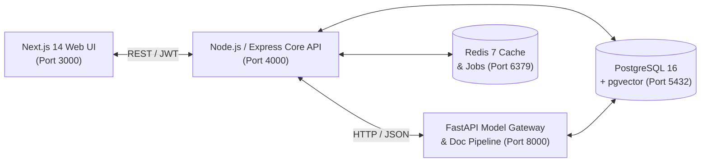

# AgentSphere: Multi-Tenant AI Agent, Knowledge & Workflow Automation Platform

[](https://github.com/agentsphere/agentsphere/actions)
[](https://www.docker.com/)
[](https://opensource.org/licenses/MIT)

> **Evaluation Level:** Advanced / Very Difficult  
> **Prepared for:** Orion LMS Technical Skills Evaluation Cohort  
> **Platform Version:** 1.0.0 Production Release  

---

## 1. Executive Summary & Capabilities
**AgentSphere** is a production-grade multi-tenant AI SaaS platform where organizations configure autonomous agents, prompt versions, tools, isolated knowledge sources, workflow steps, model providers, spending ceilings, and human-in-the-loop approval gates.

The platform provides strict data partitioning, prompt-injection defense heuristics, encrypted secret storage via AES-256-GCM, and transparent model fallback routing.

---

## 2. Architecture & Service Boundaries



- **Frontend (`apps/web`):** Next.js App Router, TypeScript, Tailwind CSS, Lucide icons.
- **Core Backend (`apps/core-api`):** Node.js, Express, TypeScript, JWT auth, RBAC, DataStore, Orchestration Engine.
- **Python Gateway (`apps/python-service`):** Python 3.11+, FastAPI, Pydantic, document extraction, vector chunking, model gateway with fallback.
- **Shared Contracts (`packages/shared`):** Canonical TypeScript interfaces and domain schemas.
- **Data Persistence:** PostgreSQL 16 schema with UUIDs, foreign keys, pgvector embeddings, and Redis.

Architecture documentation:
- [System Architecture](file:///docs/architecture/system_architecture.md)
- [Database ER Diagram](file:///docs/architecture/database_er_diagram.md)
- [End-to-End Data Flow](file:///docs/architecture/data_flow.md)

---

## 3. Seed Accounts & Multi-Tenant Credentials

The database seeds two distinct enterprise tenants with five role-based accounts (Default password: `Password123!`):

| Organization | Slug | User Email | Role | Monthly Budget | Purpose |
| :--- | :--- | :--- | :--- | :--- | :--- |
| **Acme Corporation** | `acme-corp` | `owner@acme.com` | `OWNER` | $500.00 | Organization admin |
| Acme Corporation | `acme-corp` | `builder@acme.com` | `AI_BUILDER` | $500.00 | Agent & workflow design |
| Acme Corporation | `acme-corp` | `operator@acme.com` | `WORKFLOW_OPERATOR` | $500.00 | Human approval sign-off |
| Acme Corporation | `acme-corp` | `auditor@acme.com` | `AUDITOR` | $500.00 | Read-only compliance |
| **Globex Logistics** | `globex-logistics` | `lead@globex.com` | `OWNER` | $150.00 | Competitor tenant (isolation test) |

---

## 4. Quick Start & Local Run

### Prerequisites
- Node.js >= 20.x
- Python >= 3.11
- Docker & Docker Compose (optional for full containerization)

### Setup & Install
```bash
# 1. Clone & install root monorepo dependencies
npm install

# 2. Build shared contracts
npm run build --workspace=@agentsphere/shared

# 3. Environment variables
cp .env.example .env
```

### Running with Docker Compose
```bash
docker compose up --build
```
- **Next.js Web:** `http://localhost:3000`
- **Core API Backend:** `http://localhost:4000/api/v1`
- **Python Gateway:** `http://localhost:8000/docs`

---

## 5. Automated Test Execution

All test suites run completely self-contained with mock adapters enabled:

### Run Core API Jest Test Suites (20 tests)
```bash
cd apps/core-api
npm test
```
- `auth.test.ts`: Login, token verification, API key auth.
- `auth_and_rbac.test.ts`: Role-based access control.
- `tenant_isolation.test.ts`: Strict cross-tenant access denial.
- `orchestration.test.ts`: Human-in-the-loop approval pause & resume.
- `security_and_safety.test.ts`: AES-256-GCM encryption, prompt injection shield, budget tripwire, tool allowlist.

### Run Python Gateway Pytest Suites (9 tests)
```bash
cd apps/python-service
python -m pytest tests -v
```
- `test_document_pipeline.py`: Text extraction, chunking, overlap, embedding calculation, benchmark.
- `test_model_gateway.py`: Unified completion, timeout retry, outage fallback.
- `test_guardrails.py`: Prompt injection detection and credential redaction.

### Run Production Incident Simulation (5 incidents)
```bash
python scripts/simulate_incidents.py
```

---

## 6. Mandatory Hands-On Assessments Summary (01 to 15)

Complete assessment handbooks with evidence are cataloged in [`docs/assessments/`](file:///docs/assessments/README.md):

1. **Assessment 01: AI SaaS Frontend** — Next.js 14 App Router, reactive studio, live canvas, traces viewer, approvals inbox, and billing meter.
2. **Assessment 02: AI Platform Backend** — Modular Node.js/Express REST APIs with JWT, refresh tokens, and rate limits.
3. **Assessment 03: AI Data Architecture** — PostgreSQL schemas, migrations, foreign key constraints, indexes, and seed datasets.
4. **Assessment 04: AI Platform Security** — AES-256-GCM encryption for secrets, scoped API keys (`asp_live_...`), and prompt injection heuristics.
5. **Assessment 05: Python Document Pipeline** — MIME validation, text extraction, token chunking with overlap, and similarity search.
6. **Assessment 06: FastAPI Model Gateway** — Unified provider abstraction, SSE streaming, retry backoff, usage metering, and provider health checks.
7. **Assessment 07: Agent Orchestration Engine** — Multi-step bounded execution loop, tool allowlists, human-in-the-loop approval pause & resume.
8. **Assessment 08: AI Provider Integrations** — OpenAI/Anthropic provider adapters and deterministic mock/fallback gateway.
9. **Assessment 09: Docker AI Infrastructure** — Multi-stage Dockerfiles and `docker-compose.yml` with health checks and memory limits.
10. **Assessment 10: Git & Prompt Version Governance** — Prompt version history, diff viewer, and rollback capabilities.
11. **Assessment 11: AI CI/CD and Evaluations** — GitHub Actions pipelines (`ci.yml`, `evals.yml`, `security.yml`).
12. **Assessment 12: AI Safety and Reliability Testing** — Comprehensive test suites for injection, cross-tenant isolation, loop guards, and cost ceilings.
13. **Assessment 13: AI API Documentation** — OpenAPI 3.0 specification (`openapi.json`) and Postman collection (`postman_collection.json`).
14. **Assessment 14: AI SaaS Deployment** — Production deployment guide, backup (`backup_db.sh`), and restore (`restore_db.sh`) validation.
15. **Assessment 15: AI Incident Simulation & RCA** — 5 detailed incident runbooks, reproduction scripts, root-cause analyses, and architectural mitigations.
