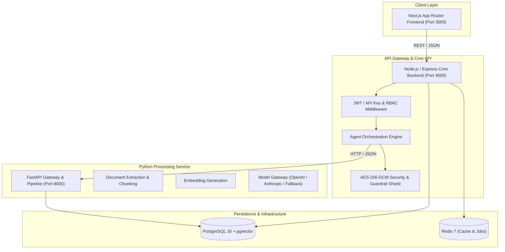

# AgentSphere System Architecture

## 1. High-Level Modular Architecture

AgentSphere follows a modular microservice architecture designed for multi-tenant isolation, resilience, and horizontal scalability.

## 2. Service Responsibilities & Authority

| Service | Primary Responsibility | Data Entities Owned |
| :--- | :--- | :--- |
| **Next.js Web** | User Interface, Canvas, Traces, Approval Cockpit | Client-side UI state, token session cache |
| **Node.js Core API** | Business Logic, Authorization, Orchestration, Budgeting | `tenants`, `users`, `agents`, `prompt_versions`, `tools`, `executions`, `human_approvals`, `usage_metrics`, `audit_logs` |
| **Python FastAPI** | Document text extraction, token chunking, model gateway routing, fallback handling | `document_chunks`, vector embeddings, streaming completions |
| **PostgreSQL** | Durable relational storage, ACID compliance, constraints, indexes | System of record for all platform entities |
| **Redis** | Rate-limiting buckets, execution lock state, asynchronous task queue | Ephemeral locks, cached quota counters |
